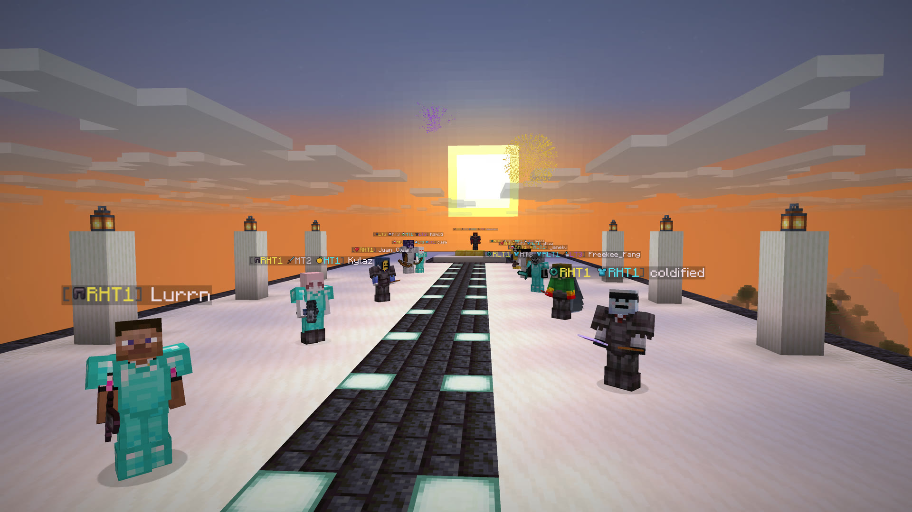

# Just-Tiers

PvP tiers from PvPTiers, PvPHQ, SubTiers and NovaTiers, right in player nametags. Turn on all
four and every nametag shows each site's best placement side by side.

*Live tiers on ranked players' nametags in Just-Tiers 1.2.1.*

- **Four tier lists in one mod.** Turn each site on or off on its own.
- **Every current version.** Builds for Minecraft 1.21.10, 1.21.11, 26.1, 26.1.1, 26.1.2, 26.2 and 26.3.
- **Full player lookup.** `/justtiers lookup <player>` shows the skin and every known gamemode on every site.
- **Client-side only.** Nothing to install on the server.
- **Open source, no analytics.** MIT licensed. Release JARs are built from their tagged commit by the
  public [GitHub Actions release workflow](https://github.com/w0x7y/Just-Tiers/actions/workflows/release.yml).

## Nametags

With one site enabled, the badge shows your selected gamemode for that site and falls back to the
player's best placement there. With several sites enabled, each shows its best placement. Turn on
Prefer selected gamemodes to have every enabled site show your selected gamemode first, falling
back to its best placement. Icons identify the gamemode and colors identify the site.

Retired placements have an R prefix, such as RHT1, and you can hide them. PvPHQ middle tiers such
as MT3 sit between HT3 and LT3. A nametag fills in as sites answer, and the tab list and chat are
unchanged.

## Player lookup

The lookup screen fills in each site as it answers. A dash means no placement was reported, not
that the player was never tested. Unavailable sites get their own message. Cached placements stay
visible while refreshing, and cell tooltips show their age. You can change the name, retry, scroll
results in smaller windows and use the keyboard throughout. Recent lookups appear as buttons and in
tab completion. They last for the current game session and are never saved.

## Customize

- Move badges before or after names, hide icons or brackets, and hide your own badge.
- Pick the default palette, Color vision alternative, high contrast or your own colors per site.
  The alternatives may help tell sites apart, but visibility still depends on your vision and the
  background.
- Show retired placements or active placements only.
- Set cache and NovaTiers refresh intervals between 5 and 1440 minutes. The defaults are 60 and 30.

Open the settings with `/justtiers gui`, ModMenu or the Just-Tiers keybind, which starts unbound.
The live preview uses example tiers and sends no leaderboard request. Save applies your edits and
Cancel discards them. If a save fails, the screen keeps your previous settings and shows an error.
A settings command that cannot save warns that its change lasts only for the current session.

## Install

Put the Just-Tiers JAR for your exact game version in your `mods` folder with Fabric API and
YetAnotherConfigLib (YACL) built for the same version. ModMenu is optional and adds a config button
to the mod list.

| Minecraft | Java | Fabric Loader | YACL |
|---|---|---|---|
| 1.21.10, 1.21.11 | 21 | 0.19 or newer | 3.8.2 or newer |
| 26.1, 26.1.1, 26.1.2, 26.2 | 25 | 0.19 or newer | 3.9.4 or newer |
| 26.3 | 25 | 0.19.5 or newer | 3.9.7 or newer |

## Commands

| Command | Action |
|---|---|
| `/justtiers` | Show settings and index status |
| `/justtiers gui` | Open configuration |
| `/justtiers lookup <player>` | Open a player lookup |
| `/justtiers toggle` | Toggle nametag tiers |
| `/justtiers site <site> [true\|false]` | Toggle or set `pvptiers`, `pvphq`, `subtiers` or `novatiers` |
| `/justtiers gamemode [site] <slug>` | Set a site's gamemode; the site is optional with one site enabled |
| `/justtiers preferselected` | Toggle preferring every enabled site's selected gamemode |
| `/justtiers retired` | Toggle retired tiers in nametags |
| `/justtiers badge <before\|after>` | Move the badge |
| `/justtiers icons` or `/justtiers brackets` | Toggle those badge decorations |
| `/justtiers ownbadge` | Toggle hiding your own badge |
| `/justtiers palette <palette>` | `default`, `colorblind`, `high_contrast`, `custom` |
| `/justtiers refresh` | Recheck cached placements and refresh NovaTiers |
| `/justtiers debug` | Print and copy a diagnostic report |

The [README](https://github.com/w0x7y/Just-Tiers#readme) lists all 43 supported gamemodes and every
configuration field. A gamemode a site adds later still shows its placements, with a name taken from
the site and no icon, but you can't select it for nametags until a mod update adds it.

## New in 1.2.1

One invalid value in the config file now falls back on its own instead of resetting every
setting, and a file that is not valid JSON is backed up before defaults load. Every network
request has a deadline, so a stalled server can no longer hold a request slot. Nametag
badges are rebuilt only when settings or answers change. An empty NovaTiers refresh no
longer turns every NovaTiers player unranked, and `/justtiers lookup` retries a site whose
nametag request failed. Keyboard focus survives window resizes, and the narrator announces
the selected gamemode tile.
[Full release notes](https://github.com/w0x7y/Just-Tiers/blob/main/docs/releases/v1.2.1.md).

## Network use

There is no mod analytics endpoint. PvPTiers, PvPHQ and SubTiers receive the account UUID being
looked up. NovaTiers supplies a bulk list, with no per-player identifier in that request.
Mojang receives a typed name if the tab list cannot resolve it to an account UUID. Displaying
the skin can also contact Mojang profile/session services and Minecraft's skin texture hosts
through Minecraft. These services receive connection metadata, including your IP address.
The mod does not send chat, inventory or the server address to the leaderboard APIs.

Automatic nametag lookups stop when nametag tiers are disabled, and each site toggle stops
nametag lookups for that site. Lookup screens and NovaTiers' startup, scheduled and requested
downloads still run. Hiding the download indicator does not stop downloads. Manual refresh and
failure retries can make requests before a cached answer's usual expiry, so the cache interval
is not a strict request-rate guarantee. Another installed mod that uses the
[tier-query API](https://github.com/w0x7y/Just-Tiers/blob/main/docs/api.md) makes automatic
lookups too, so the same switches apply: it gets no answer and causes no request for a
site while that site, or nametag tiers, are turned off. Like nametags, it never sends a UUID
that is not an online-mode account, such as an offline-mode player or a server NPC.

Failed or malformed responses are not shown as unranked players. A player or Mojang request
fails after 20 seconds without an answer, a NovaTiers download after two minutes. Retries back
off, and repeated site failures temporarily pause new requests. Failed NovaTiers refreshes keep
usable cached data without resetting its original age. Old answers stay visible for up to six
additional hours beyond the configured cache interval, then become unavailable. Valid unranked
replacements remove old badges. NovaTiers records with an identifiable player but malformed or
conflicting placements are unavailable rather than unranked. Its first download shows bytes and a
moving bar. Later percentages are estimates based on the last successful download's size, which
can change.

Each site allows four active player requests and 128 queued requests, with explicit lookups
ahead of nametag work. Queue pressure defers background requests. HTTP Retry-After cooldowns
apply to rate-limited requests and bulk downloads, capped at 24 hours. Missing or invalid hints
on HTTP 429 use 60 seconds. Refresh preserves those cooldowns and last successful placements.
Per-site caches and retry records are capped at 4096 players each, with periodic idle cleanup.

Settings are saved in `config/justtiers.json`. Existing MCTiers settings migrate to PvPTiers
and old display modes become individual site toggles. Minecraft can cache skins on disk, errors
go to the client log, and `/justtiers debug` writes its report to the clipboard.

## Reporting problems

Run `/justtiers debug` and include its copied report, reproduction steps and relevant logs or
screenshots in a [GitHub issue](https://github.com/w0x7y/Just-Tiers/issues). `PAUSED` means the
mod is waiting before probing a site that repeatedly failed. Diagnostics remain in English.

## Credits and licensing

Just-Tiers is maintained by Idan Gilboa under the [MIT license](https://github.com/w0x7y/Just-Tiers/blob/main/LICENSE).
Gamemode icons in versions after 1.2.1 are original project artwork under MIT. Versions up to 1.2.1
use PvPTiers, PvPHQ and SubTiers icon textures from [TierTagger](https://github.com/mctiers-dev/TierTagger)
by uku and netiyiy. See [NOTICE](https://github.com/w0x7y/Just-Tiers/blob/main/NOTICE).

Code and documentation include AI-assisted work reviewed by the maintainer.

Thanks to PvPTiers, PvPHQ, SubTiers and NovaTiers for their leaderboards and public APIs. Just-Tiers is
unofficial and is not affiliated with these services, Mojang or Microsoft.
