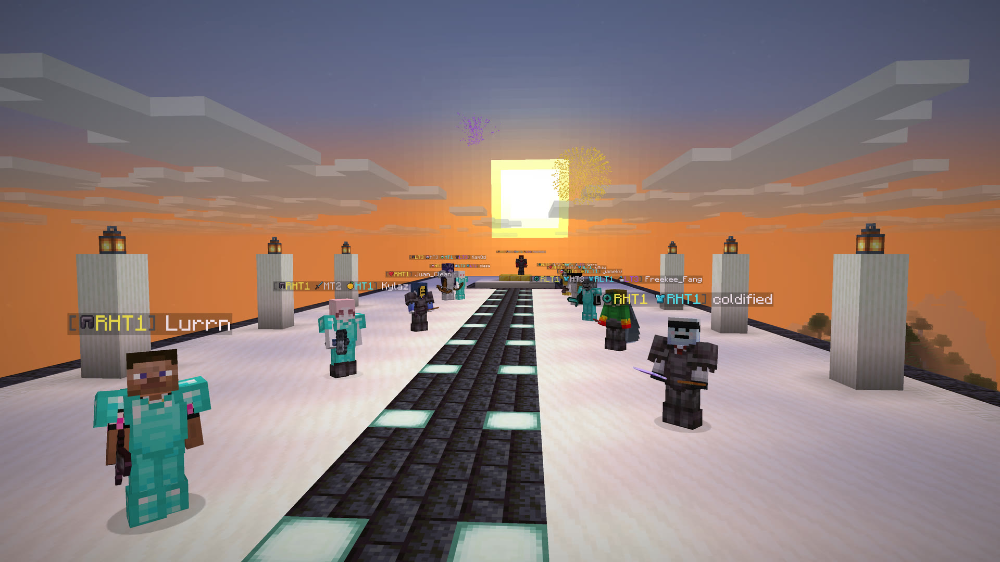

# Just-Tiers

[](https://github.com/w0x7y/Just-Tiers/actions/workflows/build.yml)

See players' PvP tiers from [PvPTiers](https://pvptiers.com), [PvPHQ](https://pvphq.com),
[SubTiers](https://subtiers.net) and [NovaTiers](https://novatiers.com) right on their nametags.
Just-Tiers is a client-side Fabric mod, so there's nothing to install on the server.



The latest version is 1.2.2, which brings new original gamemode icons
([release notes](docs/releases/v1.2.2.md)). It runs on Minecraft 1.21.10 through 26.3.

## What you get

- **Tiers on nametags.** Each site's tier sits side by side. The icon shows the gamemode and the
  color shows the site.
- **Player lookup.** `/justtiers lookup <player>` shows a player's skin and every gamemode on all
  four sites.
- **Your setup.** Turn sites on or off, pick a gamemode per site, and move or restyle the badge.
- **No analytics.** The mod only talks to the tier sites and Mojang. MIT licensed.

## Install

1. Install [Fabric Loader](https://fabricmc.net/use/) 0.19 or newer.
2. Put the Just-Tiers JAR for your exact Minecraft version in your `mods` folder, along with
   [Fabric API](https://modrinth.com/mod/fabric-api) and
   [YetAnotherConfigLib](https://modrinth.com/mod/yacl) (YACL) for the same version.
3. Optionally add [ModMenu](https://modrinth.com/mod/modmenu) for a settings button in the mod list.

| Minecraft | Java | Fabric Loader | YACL |
|---|---|---|---|
| 1.21.10, 1.21.11 | 21 | 0.19+ | 3.8.2+ for your version |
| 26.1, 26.1.1, 26.1.2 | 25 | 0.19+ | 3.9.4+ for 26.1 |
| 26.2 | 25 | 0.19+ | 3.9.4+ for 26.2 |
| 26.3 | 25 | 0.19.5+ | 3.9.7+ for 26.3 |

Use the JAR without `-sources` or `-dev` in its name. Exact dependency pins are in
[gradle/targets](gradle/targets).

## How badges work

All four sites are on by default, and each shows the player's best tier. With only one site on,
the badge shows your chosen gamemode for that site instead, or the player's best tier there if
they aren't ranked in it. Turn on **Prefer selected gamemodes** to use your chosen gamemode on
every site.

Tiers go from LT5 up to HT1. Retired tiers have an R in front, like RHT1, and you can hide them.
PvPHQ's middle tiers, like MT3, sit between HT3 and LT3. A gamemode the mod doesn't know yet still
shows its tier, just without an icon. Badges fill in as each site answers, and the tab list and
chat stay as they are.

## Looking players up

`/justtiers lookup Notch` opens a screen with the player's skin and a row for each site. It always
shows all four sites and retired tiers, whatever your nametag settings.

- A dash means the site reported no placement. It doesn't say whether the player was ever tested.
- A site that is still loading or unavailable says so instead of looking unranked.
- Tooltips show how old each answer is, and cached tiers stay visible while refreshing.
- Change the name or retry right on the screen. It works with the keyboard and scrolls in small
  windows.
- Your last eight lookups appear as buttons and in tab completion. They are cleared when you
  restart the game.

## Commands

Every command runs on your client.

| Command | What it does |
|---|---|
| `/justtiers` | Show your settings, gamemodes and the NovaTiers index size |
| `/justtiers gui` | Open the settings |
| `/justtiers lookup <player>` | Look up a player on all four sites |
| `/justtiers toggle` | Turn nametag tiers on or off |
| `/justtiers site <site> [true\|false]` | Toggle `pvptiers`, `pvphq`, `subtiers` or `novatiers` |
| `/justtiers gamemode [site] <slug>` | Choose a site's gamemode; skip the site when only one is on |
| `/justtiers preferselected` | Toggle Prefer selected gamemodes |
| `/justtiers retired` | Show or hide retired tiers on nametags |
| `/justtiers badge <before\|after>` | Put the badge before or after the name |
| `/justtiers icons` | Show or hide gamemode icons |
| `/justtiers brackets` | Show or hide badge brackets |
| `/justtiers ownbadge` | Show or hide your own badge |
| `/justtiers palette <palette>` | Choose `default`, `colorblind`, `high_contrast` or `custom` |
| `/justtiers refresh` | Recheck cached tiers and download a fresh NovaTiers list |
| `/justtiers debug` | Print a diagnostic report and copy it to the clipboard |

## Settings

Open the settings with `/justtiers gui`, ModMenu, or a keybind you can set under Options > Controls.
A live preview shows your changes using example tiers and doesn't contact any site. Save keeps your
changes, Cancel throws them away and Undo goes back to your saved settings. If saving fails, your
old settings stay in place and you see an error. A command that can't save warns that its change
lasts only for this session.

| Palette | PvPTiers | PvPHQ | SubTiers | NovaTiers |
|---|---|---|---|---|
| Default | `#FFFF55` yellow | `#D2D2D2` gray | `#55FFFF` cyan | `#AA55FF` purple |
| Color vision alternative | `#E69F00` orange | `#CC79A7` pink | `#56B4E9` sky blue | `#FFFFFF` white |
| High contrast | `#FFFFFF` white | `#FF55FF` magenta | `#FFAA00` amber | `#00FFFF` cyan |
| Custom | Your color | Your color | Your color | Your color |

The alternative palettes change hue and brightness contrast. How well they work depends on your
eyes and the background. Icons keep their own colors.

### Config file

Settings live in `config/justtiers.json` in your Minecraft instance. These are the defaults:

```json
{
  "enabled": true,
  "showRetired": true,
  "enabledSites": {
    "PVPTIERS": true,
    "PVPHQ": true,
    "SUBTIERS": true,
    "NOVATIERS": true
  },
  "selectedGamemodes": {
    "PVPTIERS": "crystal",
    "PVPHQ": "vanilla",
    "SUBTIERS": "elytra",
    "NOVATIERS": "vanilla"
  },
  "preferSelectedGamemodes": false,
  "novaRefreshMinutes": 30,
  "tierCacheMinutes": 60,
  "showDownloadProgress": true,
  "badgePosition": "before",
  "showIcons": true,
  "showBrackets": true,
  "hideOwnBadge": false,
  "palette": "default",
  "customColors": {}
}
```

Both intervals accept 5 to 1440 minutes, and custom colors use `#RRGGBB` per site. A missing or
invalid value falls back to its default without touching the rest of the file. A file that isn't
valid JSON is copied to `justtiers.json.bak` before the defaults load. Settings from older versions
move over on their own, including MCTiers settings, which become PvPTiers settings. The exact
loading rules are in [How it works](docs/how-it-works.md#config-file).

## Supported gamemodes

Each site runs its own competition. Use these slugs with `/justtiers gamemode` and in the config file.

| Site | Gamemodes |
|---|---|
| **PvPTiers** (8) | Axe (`axe`), Crystal (`crystal`), Mace (`mace`), Netherite Pot (`neth_pot`), Pot (`pot`), SMP (`smp`), Sword (`sword`), UHC (`uhc`) |
| **PvPHQ** (11) | Axe (`axe`), Cart (`cart`), Diamond SMP (`diamond_smp`), Mace (`mace`), Netherite Pot (`netherite_pot`), Pot (`pot`), SMP (`smp`), Spear (`spear_mace`), Sword (`sword`), UHC (`uhc`), Vanilla (`vanilla`) |
| **SubTiers** (12) | Bed (`bed`), Bow (`bow`), Creeper (`creeper`), DeBuff (`debuff`), Diamond SMP (`dia_smp`), Diamond Vanilla (`dia_crystal`), Elytra (`elytra`), Manhunt (`manhunt`), Minecart (`minecart`), OG Vanilla (`og_vanilla`), Speed (`speed`), Trident (`trident`) |
| **NovaTiers** (12) | Axe (`axe`), Diamond Cart (`diamondcart`), Diamond OP (`diamondop`), Elytra (`elytra`), Elytra Spear (`elytraspear`), Modern SMP (`modernsmp`), Pufferfish (`pufferfish`), SMP (`smp`), Spear Mace (`spearmace`), Spleef (`spleef`), UHC (`uhc`), Vanilla (`vanilla`) |

If a site adds a new gamemode, its tiers still show up, named after the site's identifier
(`bed_wars` becomes Bed Wars) and without an icon. You can pick it for nametags once a mod update
adds it.

## Privacy and network use

Just-Tiers has no analytics. It only contacts:

- **PvPTiers, PvPHQ and SubTiers**, sending the account UUID of a player on screen or one you look up.
- **NovaTiers**, downloading its whole list in one request with no player ID in it.
- **Mojang**, to turn a typed name into a UUID when the tab list can't, and through Minecraft to
  load skins on the lookup screen.

These services see ordinary connection details such as your IP address. Chat, inventory and the
server address are never sent. Offline-mode players and server NPCs are never looked up
automatically.

Turning off nametag tiers, or a single site, stops automatic lookups for it, including lookups from
other mods that use the [tier-query API](docs/api.md). The lookup screen still works, and the
NovaTiers list still downloads at startup, on its schedule and when you refresh. Answers are cached
for an hour by default and the NovaTiers list refreshes every 30 minutes. Manual refresh and retries
can make requests sooner, so the cache interval isn't a strict limit.

Failed or broken responses never show as unranked. Retries back off, and a site that keeps failing
is paused for a while. [How it works](docs/how-it-works.md) has every rule, timeout and limit.

## Reporting a bug

Run `/justtiers debug` and paste the copied report into a
[GitHub issue](https://github.com/w0x7y/Just-Tiers/issues), with steps to reproduce, your game and
mod versions, and any logs or screenshots. `PAUSED` in the report means a site failed repeatedly
and the mod is waiting before trying it again. The report is always in English.

## For mod developers

Other Fabric client mods can read Just-Tiers' answers through `JustTiersQuery` in
`com.w0x7y.justtiers.query`. Each site's answer is disabled, pending, unavailable, unranked or
ranked. Reads never block, but a read can start the same lookup a nametag would and obeys the same
toggles. See [the API guide](docs/api.md) for setup, threading and network details.

## Building from source

You need JDK 25 on your PATH or in `JAVA_HOME`. Gradle downloads any other compiler a target needs,
such as Java 21 for 1.21.10 and 1.21.11.

```bash
git clone https://github.com/w0x7y/Just-Tiers.git
cd Just-Tiers
./gradlew build
./gradlew runClient
# Another target:
./gradlew build -Pminecraft_version=1.21.10
```

On Windows use `gradlew.bat`. The default target is 26.2, and JARs land in
`build/<minecraft-version>/libs/`. Development and sources JARs there aren't installable mods.
`build` runs every test, including resource checks for icons and translations, but it doesn't
launch Minecraft.

For changes to the game client, run the [runtime smoke checklist](docs/runtime-smoke-test.md).
More guides:

- [Minecraft compatibility](docs/minecraft-compatibility.md): how each target builds and how to verify all of them.
- [Verification tools](docs/verification-tools.md): the badge benchmark and the smoke-test client.
- [CI and releases](docs/releasing.md): build checks, tagging a release and syncing the Modrinth listing.

## Contributing

Run `./gradlew build` before opening a pull request. Keep game logic free of Minecraft types where
you can, and keep the Minecraft integration thin. [CLAUDE.md](CLAUDE.md) describes the module
boundaries and [docs/adr](docs/adr) records past decisions. Plans in `docs/superpowers` are archived
history, not instructions.

To add a gamemode, register it in `tier/Gamemodes.java`, add it and its texture to
`tools/gen_font_provider.py`, then run `python3 tools/gen_font_provider.py` and `./gradlew check`.
The generator only binds existing artwork. New icons must be original work.

## Credits and licensing

Just-Tiers is made by Idan Gilboa and released under [MIT](LICENSE). Since 1.2.2, every gamemode icon
is original project artwork under MIT. Versions up to 1.2.1 shipped PvPTiers, PvPHQ and SubTiers icons
from [TierTagger](https://github.com/mctiers-dev/TierTagger); see [NOTICE](NOTICE). Code,
documentation and the gamemode icons include AI-assisted work reviewed by the maintainer.

Thanks to PvPTiers, PvPHQ, SubTiers and NovaTiers for their leaderboards and public APIs.
Just-Tiers is unofficial and isn't affiliated with those sites, Mojang or Microsoft.
